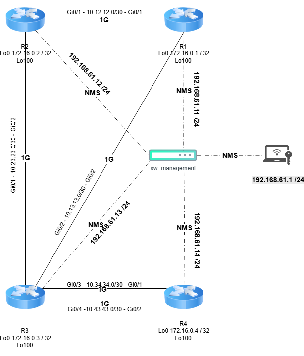

# Cisco IS-IS Network Automation

🌍 *Choose language:* [English](#english-version) | [Bahasa Indonesia](#versi-indonesia)

---

##  🇬🇧 English Version

This repository contains Python automation scripts for configuring and verifying IS-IS (Intermediate System to Intermediate System) routing protocols on Cisco IOSv routers. It demonstrates enterprise-grade network automation, topology management, and traffic failover engineering.

### 🏗️ Network Topology
*   **Routing Protocol:** IS-IS (Level-2 Only).
*   **Management Network:** 192.168.61.0/24 (Out-of-Band via SSH).
*   **Core / Distribution:** R1, R2, R3 (Ring Topology).
*   **Access / Edge:** R4 (Dual-Homing to R3).
    *   *Primary Link (Fiber):* Interface Gi0/3 (Metric 10).
    *   *Backup Link (Microwave):* Interface Gi0/4 (Metric 100).

### 🛠️ Tech Stack & Tools
*   **Language:** Python 3.x
*   **Libraries:** `netmiko`, `csv`, `warnings`
*   **Emulator:** GNS3 (Cisco IOSv)
*   **Protocol:** SSH (adapted with `diffie-hellman-group14-sha1` and `ssh-rsa` for legacy support).

### 🚀 Automation Scripts
This project consists of several modular Python scripts:
1.  `hosts1.csv`: The inventory database containing Management IPs and router hostnames.
2.  `cisco_audit.py`: A Read-Only script to extract router data (Show Version, Interface Brief, CDP Neighbors).
3.  `cisco_isis.py`: A Push Configuration script to inject IP Addresses, Loopbacks, and initiate the IS-IS process along with its metrics.
4.  `cisco_verify.py`: A post-configuration verification script to extract Routing and Neighbor tables, ensuring IS-IS convergence.

### 📊 Failover Testing (Traffic Engineering)
The failover logic has been successfully validated. When the primary Fiber Optic link (R3-R4) is disrupted (simulated via interface `shutdown`), the IS-IS protocol instantly recalculates the SPF tree and reroutes traffic through the backup Microwave link (Metric 100) with zero noticeable downtime.

---

##  🇮🇩 Versi Indonesia

Repositori ini berisi skrip automasi Python untuk mengonfigurasi dan memverifikasi protokol routing IS-IS (Intermediate System to Intermediate System) pada router Cisco IOSv. Proyek ini mendemonstrasikan automasi jaringan skala *enterprise*, manajemen topologi, dan *traffic failover engineering*.

### 🏗️ Topologi Jaringan
*   **Routing Protocol:** IS-IS (Level-2 Only).
*   **Management Network:** 192.168.61.0/24 (Out-of-Band via SSH).
*   **Core / Distribution:** R1, R2, R3 (Topologi Ring).
*   **Access / Edge:** R4 (Dual-Homing ke R3).
    *   *Jalur Utama (Fiber):* Interface Gi0/3 (Metric 10).
    *   *Jalur Backup (Microwave):* Interface Gi0/4 (Metric 100).

### 🛠️ Tech Stack & Tools
*   **Python 3.x**
*   **Library:** `netmiko`, `csv`, `warnings`
*   **Emulator:** GNS3 (Cisco IOSv)
*   **Protokol:** SSH (dengan penyesuaian algoritma `diffie-hellman-group14-sha1` dan `ssh-rsa` untuk *legacy support*).

### 🚀 Skrip Automasi (Python Scripts)
Proyek ini terdiri dari beberapa skrip Python modular:
1.  `hosts1.csv` : Database *inventory* berisi daftar IP Management dan *hostname* router.
2.  `cisco_audit.py` : Skrip *Read-Only* untuk mengekstrak data dari router (Show Version, Interface Brief, CDP Neighbors).
3.  `cisco_isis.py` : Skrip *Push Configuration* untuk menyuntikkan IP Address, Loopback, dan menyalakan proses IS-IS beserta metriknya.
4.  `cisco_verify.py` : Skrip verifikasi pasca-konfigurasi untuk mengekstrak tabel *Routing* dan *Neighbors* guna memastikan konvergensi IS-IS.

### 📊 Hasil Pengujian Failover (Traffic Engineering)
Logika *failover* berhasil divalidasi. Saat jalur Fiber Optic R3-R4 diputus (melalui simulasi `shutdown` interface), protokol IS-IS secara instan menghitung ulang rute dan memindahkan aliran trafik ke jalur Microwave (Metric 100).